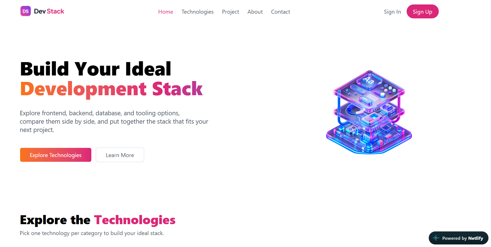
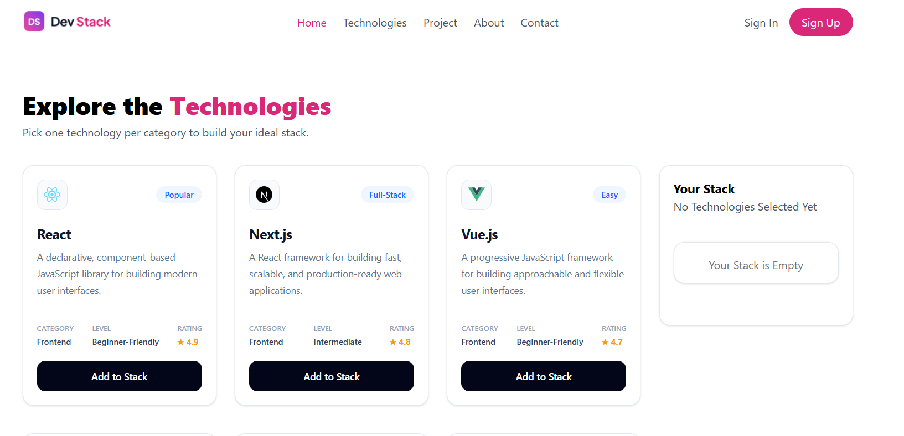

# 🚀 DevStack

DevStack is a modern and interactive web application that helps developers explore popular technologies across different categories such as Frontend, Backend, Database, Language, Styling, DevOps, and Tools. Users can build and manage their personal technology stack by adding and removing technologies.

## 🌐 Live Demo

[DevStack Live Website](https://devstack-assignment-5-ph.netlify.app/)

## 📸 Screenshots

### 1. Home

### 2. My Stack 

### 3. Added Technology

## 🛠️ Technologies Used

- **React** — Component-based user interface
- **Tailwind CSS** — Modern and responsive styling
- **JavaScript** — Application functionality
- **HTML5** — Web page structure
- **JSON** — Technology data management
- **Netlify** — Deployment and hosting

## ✨ Features

### 1. Explore Technologies
Browse popular technologies across Frontend, Backend, Database, Language, Styling, DevOps, and Tools categories.

### 2. Technology Details
View technology ratings, difficulty levels, descriptions, and other relevant information.

### 3. Add Technology
Add new technologies to the collection and expand the available technology library.

### 4. My Stack
Manage your personal technology stack by adding technologies and removing individual items.

### 5. Interactive User Experience
Enjoy a clean interface with category-based exploration and interactive controls for managing technologies.

## 📌 About

DevStack is designed to help developers discover technologies, explore useful information, and organize the tools and technologies they want to work with in one place.

---

**DevStack — Explore. Build. Grow.**